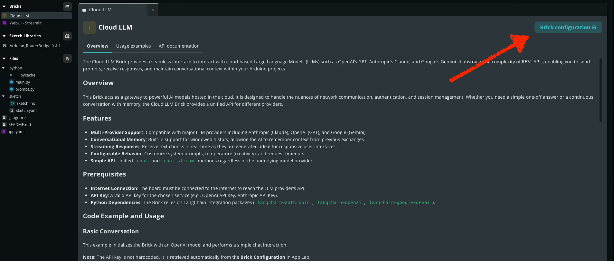

# Project 2 \- Robot Bridges

Your colleague Clement is working on a device for Star Shine Props LLC that leverages an LLM to explore novel noises for robot props.

A user will enter a prompt in a web application, and a buzzer will play a short melody.

Clement has written all the Python code and all the Arduino code, but needs you to handle the bridge between the two.

In order to complete this work order, you will need to get an API key from Anthropic (details below).  Clement was supposed to share the company API key with you, but he forgot and then went on vacation.

## Your tasks:

For all coding tasks below, look for comment sections that direct you where to write your code.

1. Wire a piezo buzzer circuit to pin A3 on your Arduino Q board.  
2. In the Arduino sketch, **begin** the bridge communication.  
3. In the Arduino sketch, **provide\_safe** the function `playSounds`.  
4. In the Python file, **call** or **notify** `playSounds` with one argument: `melody`.
5. Get an API key from Anthropic (see notes)
6. Enter API Key in Cloud LLM Brick Conifguration

## Notes:

Once you have an API key, enter it in the Brick configuration settings by clicking on the Brick in the left hand file explorer section, and then clicking “Brick configuration” in the top right corner of the Bricks tab.

## Testing Criteria:

Once completed with these tasks, you can check your work by ensuring the following while the App is running: 

* When you enter a prompt, the piezo buzzer responds appropriately  
* No errors in the AppLab consoles

## Get an Anthropic API Key

1. Create a Developer Account: Visit console.anthropic.com and sign up using your email or a supported provider (Google, Microsoft, or Apple).  
2. Access API Keys: Once logged in, click on the "API Keys" icon in the left-hand navigation menu (or find it under your profile name in the top right).  
3. Create a New Key:  
   1. Click the "+ Create Key" button.  
   2. Give your key a descriptive name (e.g., "My Project") to help identify it later.  
   3. Confirm by clicking "Create Key" or "Add".  
4. Secure Your Key: The full key will be displayed only once. Copy it immediately and store it in a secure location, like a password manager or environment variable.  
5. Set Up Billing: Navigate to the "Billing" section in the console to add a payment method. Anthropic uses a prepaid credit system where you must typically purchase a minimum of $5 in credits before the API key will process requests